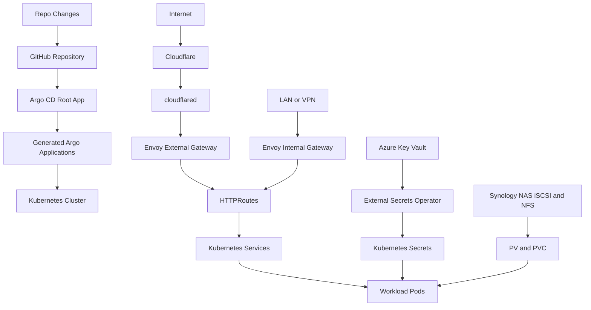
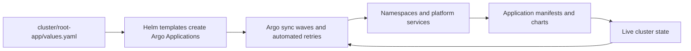
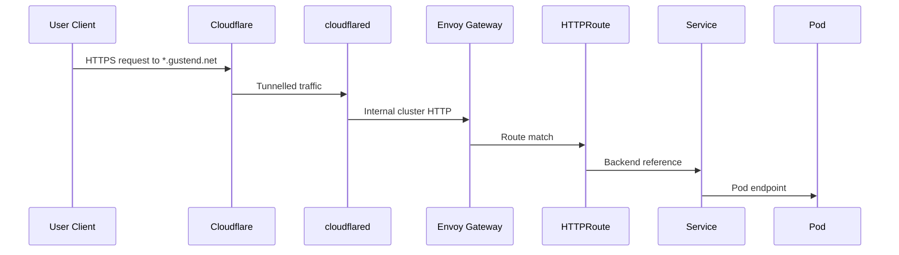

# HomeOps Project Architecture Blueprint

Generated: April 10, 2026
Repository: homeops-final-final
Primary pattern: GitOps app-of-apps on Kubernetes (Talos)
Detail level: Implementation-ready

## 1. Architecture Detection and Analysis

### Detected technology stack

- Kubernetes manifests (YAML) for workloads, routing, storage, security, and operators.
- Argo CD for GitOps reconciliation and automated drift correction.
- Helm chart wrappers for selected operators and platform components.
- Talos for immutable Kubernetes node OS and cluster bootstrap.
- Terraform (AzureRM, SOPS, TFE) for Azure Key Vault and Terraform Cloud workspace wiring.
- External Secrets Operator for secret sync from Azure Key Vault into Kubernetes Secrets.
- Envoy Gateway and Gateway API for ingress/routing.
- Cloudflare Tunnel (cloudflared) for external traffic ingress.

### Detected architectural patterns

- Primary: GitOps declarative architecture.
- Secondary:
  - App-of-apps composition via Helm-templated Argo Applications.
  - Layered platform architecture (bootstrap, platform services, workloads).
  - Hybrid deployment model (raw manifests plus Helm chart dependencies).
  - Edge gateway split (internal and external ingress paths).

Evidence highlights:

- App registry and sync orchestration: cluster/root-app/values.yaml.
- Application generation template: cluster/root-app/templates/app-set.yaml.
- Gateway dual-plane setup: cluster/apps/envoy-gateway/templates/gateway-internal.yaml and cluster/apps/envoy-gateway/templates/gateway-external.yaml.
- Terraform Cloud + Azure infra split: cluster/infra/mgmt and cluster/infra/main.

## 2. Architectural Overview

HomeOps is a declarative home-lab platform where Git is the control plane and Argo CD is the reconciler. The repository is organized so that low-level cluster bootstrap operations (snapshotter CRDs/controller and Synology CSI bring-up) are handled first, then steady-state platform and application operations are continuously enforced by Argo CD.

Guiding principles implemented in the codebase:

- Source of truth in Git: every managed resource is versioned as YAML/HCL.
- Idempotent reconciliation: Argo sync policy uses automated prune + self-heal with retries.
- Platform-first layering: ingress, cert management, storage, and secrets are provisioned before most apps.
- Explicit drift mitigation: ExternalSecret defaults are made explicit to avoid OutOfSync churn.
- Operational simplicity: mostly single-replica stateful apps, consistent labels, and revisionHistoryLimit of 1.

## 3. Architecture Visualization

### 3.1 High-level C4-style context



### 3.2 GitOps reconciliation flow



### 3.3 Request/data path flow



## 4. Core Architectural Components

### 4.1 Bootstrap layer

Purpose:

- One-time or infrequent bring-up of prerequisites not fully managed in the app-of-apps set.

Key assets:

- bootstrap/external-snapshotter-crd
- bootstrap/external-snapshotter-controller
- bootstrap/synology-csi-talos

Responsibilities:

- Install CRDs/controllers for snapshot ecosystem.
- Deploy Synology CSI integration for persistent storage.

### 4.2 GitOps control layer (Argo CD + root-app)

Purpose:

- Convert app inventory into concrete Argo Application resources and keep them reconciled.

Internal structure:

- Chart and values: cluster/root-app/Chart.yaml, cluster/root-app/values.yaml
- Templating: cluster/root-app/templates/app-set.yaml and repo-app-set.yaml

Implementation pattern:

- For each app entry in values, render one Argo Application with:
  - automated.prune and automated.selfHeal
  - retry with exponential backoff
  - CreateNamespace, ServerSideApply, ApplyOutOfSyncOnly sync options

### 4.3 Platform services layer

Includes:

- Envoy Gateway
- cert-manager
- external-secrets
- azkv-secret-store
- MetalLB
- cloudflared
- metrics-server

Responsibilities:

- Ingress, cert issuance, secret synchronization, cluster networking, platform telemetry.

### 4.4 Workload layer

Includes representative app groups:

- Media and automation: jellyfin, sonarr, radarr, lidarr, prowlarr, nzbget, deluge, tunarr, n8n
- Utility and UX: homepage, uptime-kuma, kutt
- Data services/operators: mongodb operator, postgres operator
- Specialty workloads: foundry, ddb-proxy, printers, custom web properties

## 5. Architectural Layers and Dependencies

Layer map and dependency direction:

1. Bootstrap manifests -> enable storage and snapshot primitives.
2. Argo root app -> declares all child application desired state.
3. Platform services -> provide gateway, secrets, certs, and networking capabilities.
4. Application manifests -> depend on platform CRDs/controllers and storage classes.
5. Runtime traffic and data flows -> HTTPRoute -> Service -> Pod and Secret/PVC injection.

Enforcement mechanisms:

- Sync waves in app entries (for example envoy-gateway syncWave: 1).
- Namespace-scoped manifest separation by app folder.
- Common labeling conventions (primarily app.kubernetes.io/name).

Known violation risks:

- Shared-resource ownership drift can happen when root-app and parent app both render/manage same resources; documented in docs/implementation-plan/argo-out-of-sync-remediation.md.

## 6. Data Architecture

This repository uses infrastructure data architecture rather than a single domain model codebase.

### 6.1 Persistent data patterns

- Stateful workloads attach PVCs to pods, often with Recreate strategy.
- Two dominant storage patterns:
  - synology-iscsi for app-local ReadWriteOnce volumes.
  - NFS classes for shared ReadWriteMany media volumes.

Example evidence:

- cluster/apps/jellyfin/pvc.yaml
- cluster/apps/jellyfin/storage-class.yaml
- cluster/apps/foundry/deployment.yaml

### 6.2 Secret data patterns

- Azure Key Vault is source of truth.
- ExternalSecret resources map vault keys into Kubernetes Secrets.
- Pods consume secrets through env.valueFrom.secretKeyRef.

Example chain:

- cluster/apps/azkv-secret-store/keyvault-secret-store.yaml
- cluster/apps/foundry/external-secret.yaml
- cluster/apps/foundry/deployment.yaml

### 6.3 Configuration and transformation

- Most configuration is direct declarative YAML without app-side transformation layer.
- Some configuration conversion is handled by operators/controllers (External Secrets).

## 7. Cross-Cutting Concerns Implementation

### Authentication and authorization

- Cluster-level authN/authZ relies on Kubernetes RBAC and service accounts where needed.
- External secret access uses service principal credentials referenced by ClusterSecretStore.
- App-level authentication is mostly delegated to each workload configuration and secret-provided env vars.

### Error handling and resilience

- Argo retry policies provide reconciliation resilience (retry limit 10 with backoff).
- cloudflared includes liveness probe on /ready.
- Most workloads prefer simple restart semantics over advanced circuit breakers.

### Logging and monitoring

- metrics-server is present for core metrics.
- cloudflared exposes metrics endpoint at 0.0.0.0:2000.
- No centralized logging stack is defined in current active app list.

### Validation

- Validation is primarily API-server schema validation and controller reconciliation feedback.
- Governance docs capture known drift classes and remediation playbooks.

### Configuration management

- Git-managed manifests are authoritative desired state.
- Secrets: SOPS-encrypted Terraform inputs and Azure Key Vault runtime synchronization.
- Taskfile automates encrypt/decrypt and Terraform plan/apply workflows.

## 8. Service Communication Patterns

### In-cluster synchronous communication

- HTTP and TCP communication via Service abstraction.
- Primary L7 path: HTTPRoute -> Gateway -> Service -> Pod.

### External ingress communication

- Public domains terminate at Cloudflare edge, forwarded via cloudflared tunnel to Envoy external gateway.

### Internal ingress communication

- LAN/VPN clients access Envoy internal gateway, typically via hostnames *.internal.gustend.net.

### Legacy service bridging

- EndpointSlice plus Service plus HTTPRoute pattern routes traffic to external IP hosts.
- Example: cluster/apps/plex-route/endpoints.yaml and cluster/apps/plex-route/httproute.yaml.

### Versioning and discovery

- Service discovery is DNS-based through Kubernetes service names.
- API versioning is mostly Kubernetes resource apiVersion/version pinning, not app API gateways.

## 9. Technology-Specific Architectural Patterns

### Kubernetes and YAML patterns

- One folder per app under cluster/apps.
- Consistent file naming conventions for deployment/service/httproute/pvc/external-secret.
- Frequent use of revisionHistoryLimit: 1 for Deployment resources.

### Helm patterns

- Platform/operator components and some apps are Helm chart based.
- Wrapper chart pattern for dependency pinning (for example postgres-operator).

### Terraform patterns

- Split workspaces for management and main environments:
  - cluster/infra/mgmt
  - cluster/infra/main
- SOPS provider decrypts encrypted json for secrets.
- TFE provider sets workspace environment variables centrally.

### Talos patterns

- Talos-generated immutable configs in talos/_out.
- Bootstrap commands documented as explicit CLI sequence in talos/Readme.md.

## 10. Implementation Patterns

### Interface design patterns

- Infrastructure interfaces are declarative resources (CRDs and core kinds) rather than code interfaces.
- Separation by kind acts as interface boundaries:
  - Secret source interface: ExternalSecret and ClusterSecretStore.
  - Traffic interface: HTTPRoute and Gateway.
  - Storage interface: StorageClass/PV/PVC.

### Service implementation patterns

- Standard pattern for most apps:
  - Deployment with one container
  - Resource requests/limits
  - Service ClusterIP
  - HTTPRoute for ingress

### Repository and data access analogs

- Instead of repositories in code, data access is operator-mediated:
  - External Secrets Operator for secret retrieval.
  - CSI drivers for persistent storage backing.

### API/controller implementation pattern

- Argo Application template acts as declarative controller configuration with standardized sync policy.

### Domain model implementation analog

- Domain model is the manifest graph itself: namespaced app resources plus shared platform resources.

## 11. Testing Architecture

Current testing architecture is operations-centric rather than unit-test-centric.

Observed strategy:

- Declarative validation through Kubernetes apply/reconcile outcomes.
- Drift detection through Argo status (Synced/OutOfSync and Health states).
- Targeted remediation plans in docs/implementation-plan.

Gaps:

- No repository-wide automated unit/integration test suites were detected for application manifests.
- No policy-as-code or manifest lint pipeline is documented in the inspected files.

## 12. Deployment Architecture

### 12.1 Topology

- Talos-based Kubernetes cluster.
- Envoy internal/external gateways for north-south traffic.
- Cloudflare tunnel for internet exposure.
- Synology NAS for persistent storage.
- Azure Key Vault for secret backing.

### 12.2 Deployment sequence

1. Bootstrap Talos cluster and kubeconfig.
2. Apply bootstrap snapshotter/CSI assets.
3. Deploy Argo CD and root app.
4. Argo continuously deploys platform and workload apps.
5. Terraform workspaces manage Azure key vault and workspace env wiring.

### 12.3 Environment adaptations

- Internal and external hostname domains are separated.
- Internal TLS certificate management is in-cluster via cert-manager and wildcard certificate.
- External TLS is effectively handled at Cloudflare edge before tunnel ingress.

## 13. Extension and Evolution Patterns

### Feature addition patterns

For a new app under this architecture:

1. Create app folder under cluster/apps/<name>.
2. Add Deployment with labels, resources, and revisionHistoryLimit.
3. Add Service (usually ClusterIP).
4. Add PVC/PV/StorageClass if persistent or shared storage is needed.
5. Add HTTPRoute (internal by default unless explicitly external).
6. Add ExternalSecret resources for all sensitive config.
7. Register app in cluster/root-app/values.yaml.

### Safe modification patterns

- Preserve existing labels/selectors when modifying deployments/services.
- Keep explicit ExternalSecret default fields to avoid Argo drift.
- Avoid introducing duplicate ownership of shared resources across multiple Argo apps.

### Integration patterns

- Legacy endpoint integration: EndpointSlice + Service + HTTPRoute.
- External service credentials: map from Azure Key Vault via ExternalSecret.
- Operator-based integrations are preferred over ad-hoc scripts after bootstrap.

## 14. Architectural Pattern Examples

### Example A: GitOps application generation template

Source: cluster/root-app/templates/app-set.yaml

```yaml
{{- range $index, $app := .Values.apps }}
apiVersion: argoproj.io/v1alpha1
kind: Application
metadata:
  name: {{ $app.name }}
spec:
  source:
    path: {{ $app.path }}
    repoURL: {{ $.Values.gitops.repo }}
  syncPolicy:
    automated:
      prune: true
      selfHeal: true
{{- end }}
```

Pattern shown:

- Inventory-driven app generation with standardized sync behavior.

### Example B: Secret sourcing chain

Sources:

- cluster/apps/foundry/external-secret.yaml
- cluster/apps/foundry/deployment.yaml

```yaml
apiVersion: external-secrets.io/v1
kind: ExternalSecret
metadata:
  name: foundry-admin-key
spec:
  secretStoreRef:
    name: azure-secret-store
    kind: ClusterSecretStore
```

```yaml
env:
  - name: FOUNDRY_ADMIN_KEY
    valueFrom:
      secretKeyRef:
        name: foundry-admin-key
        key: foundry-admin-key
```

Pattern shown:

- Separation of secret source from workload deployment.

### Example C: Legacy external host routing

Sources:

- cluster/apps/plex-route/endpoints.yaml
- cluster/apps/plex-route/manual-route.yaml
- cluster/apps/plex-route/httproute.yaml

```yaml
apiVersion: discovery.k8s.io/v1
kind: EndpointSlice
endpoints:
  - addresses: ["10.1.10.194"]
ports:
  - port: 32400
```

Pattern shown:

- Non-cluster backend integration while preserving Gateway routing model.

## 15. Architectural Decision Records

### ADR-001: GitOps app-of-apps as primary control pattern

- Context: Many heterogeneous applications and platform services require repeatable deployment and drift correction.
- Decision: Use Argo CD with root-app generated child applications from values inventory.
- Consequences:
  - Positive: centralized app registry and consistent sync policy.
  - Negative: potential ownership overlap if resource scopes are not carefully bounded.

### ADR-002: Dual ingress model (internal and external)

- Context: Need separate exposure semantics for LAN/VPN services vs internet-facing services.
- Decision: Use two Gateways (internal/external) with route-specific hostnames.
- Consequences:
  - Positive: clear traffic policy boundaries.
  - Negative: requires careful route and DNS discipline.

### ADR-003: Azure Key Vault as secret source with External Secrets

- Context: Avoid hardcoded Kubernetes secret values in Git.
- Decision: Pull secrets at runtime via ExternalSecret + ClusterSecretStore.
- Consequences:
  - Positive: improved secret hygiene and centralized credential lifecycle.
  - Negative: reconciliation drift risk if defaulted fields are omitted in manifests.

### ADR-004: Terraform split into mgmt and main workspaces

- Context: Need separate lifecycle concerns for foundational management credentials and main workload-related cloud resources.
- Decision: Keep two Terraform roots/workspaces and wire env vars via TFE provider.
- Consequences:
  - Positive: clearer blast-radius boundaries.
  - Negative: operational overhead of coordinating two workspaces.

## 16. Architecture Governance

Current governance mechanisms:

- Structural conventions in app folders and manifest naming.
- Copilot instructions defining app onboarding and resource expectations.
- Argo health/sync status as primary governance signal.
- Remediation runbooks in docs/implementation-plan.

Recommended incremental governance improvements:

- Add CI manifest validation (kubeconform or equivalent).
- Add policy checks (for example required labels, resource limits, and revisionHistoryLimit).
- Add periodic dead-manifest detection for non-registered app folders.

## 17. Blueprint for New Development

### Development workflow by feature type

New app:

1. Create cluster/apps/<app-name> with core manifests.
2. Add namespace-specific resources and optional storage/secrets.
3. Add route for internal or external exposure.
4. Register app in cluster/root-app/values.yaml.
5. Confirm Argo app appears and reaches Synced and Healthy.

App update:

1. Update manifests in place.
2. Validate selector/label compatibility before changing services or deployments.
3. Watch Argo reconciliation and workload rollout.

Platform extension:

1. Evaluate whether change belongs in bootstrap, platform app, or workload app.
2. Prefer adding platform components as Argo-managed app entries where feasible.
3. Document migration/remediation plan in docs/implementation-plan when behavior can impact many apps.

### Implementation templates

Minimum app resource template set:

- deployment.yaml
- service.yaml
- httproute.yaml
- pvc.yaml or external-secret.yaml as required by app

Default operational expectations:

- Deployment has resources.requests/limits and revisionHistoryLimit: 1.
- Service selector aligns with deployment labels.
- HTTPRoute parentRefs and hostnames match exposure intent.
- ExternalSecret manifests include explicit defaulted fields to prevent drift.

### Common pitfalls

- Duplicate resource ownership between root-app and child app scopes.
- Mismatched label selectors between Service and Deployment.
- Missing ExternalSecret default fields causing persistent OutOfSync.
- Exposing routes externally without explicit intent and host verification.

### Maintenance recommendation

- Regenerate this blueprint whenever one of these changes materially:
  - root-app templating model
  - ingress model (Gateway or cloudflared)
  - secret management flow
  - Terraform environment/workspace structure

- Suggested cadence: quarterly, or after major platform migrations.
